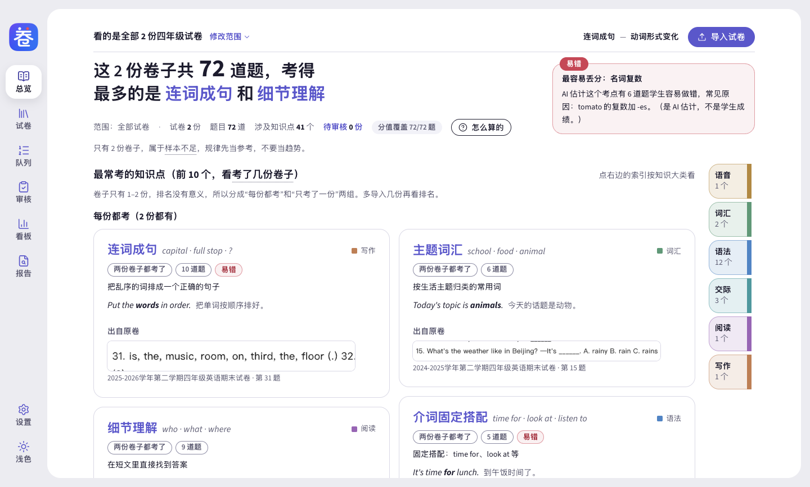
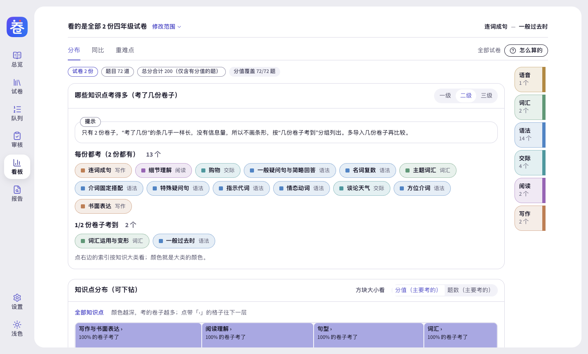
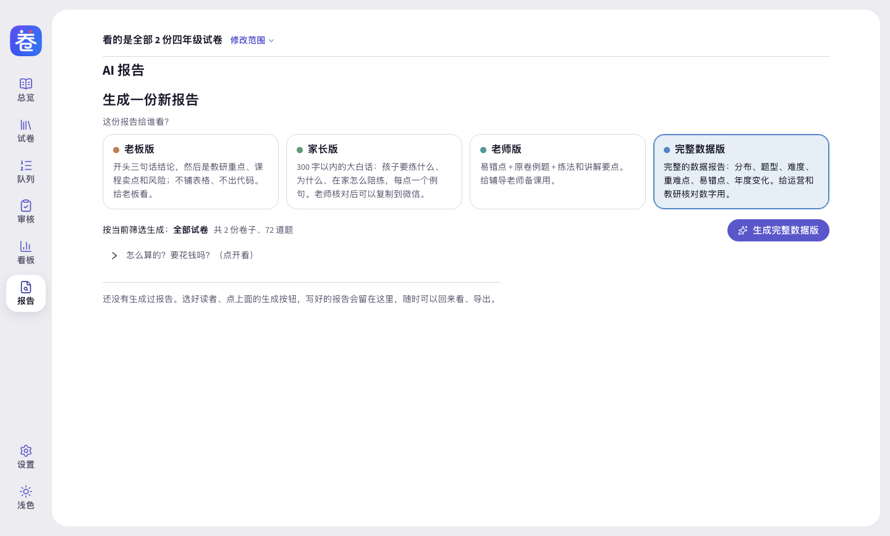

# Juanzhi (卷知) · Primary-School English Exam Analysis

[简体中文](README.md) | **English**

Turn a stack of primary-school English exam papers into a "dictionary of exam points". You can see at a glance what was tested this year, where students make the most mistakes, and what changed compared with earlier years. Then generate analysis reports for different readers: a **boss version, a teacher version and a parent version**.

- Free and open source. Installers for both Mac and Windows.
- No sign-up, no login. Your papers and results stay on your own computer. Paper text is sent to an AI service of your own choice only when you ask the AI to split questions or write a report (see [section 9](#9-data-and-privacy)).
- You do not need to know grammar terms. Every exam point comes with a plain-language explanation and an example sentence.

> **Note:** The app's interface, its AI prompts and the reports it generates are in Chinese only. It is built for Chinese primary-school English teaching (PEP-style textbooks, Chinese school years and semesters). This English README only explains how to install and use it.



> **Download: [click here to open the download page](https://github.com/ooohhhooo/juanzhi/releases/latest)**　|　Full installation guide: [docs/安装指南.md](docs/安装指南.md) (the guide is in Chinese)

---

## Contents

1. [What Juanzhi is](#1-what-juanzhi-is)
2. [Before you start: three things to check](#2-before-you-start-three-things-to-check)
3. [System requirements: which computers can and cannot run it](#3-system-requirements-which-computers-can-and-cannot-run-it)
4. [Which file to download](#4-which-file-to-download)
5. [Installation steps (Mac / Windows)](#5-installation-steps)
6. [First use: three steps](#6-first-use-three-steps)
7. [Beginner's guide: let an AI assistant install it for you (WorkBuddy, Doubao, Codex, Claude Code)](#7-beginners-guide-let-an-ai-assistant-install-it-for-you)
8. [Command line (CLI): use it yourself or hand it to an AI assistant](#8-command-line-cli-use-it-yourself-or-hand-it-to-an-ai-assistant)
9. [Data and privacy](#9-data-and-privacy)
10. [FAQ, known limitations and feedback](#10-faq-known-limitations-and-feedback)
11. [For developers](#11-for-developers)

---

## 1. What Juanzhi is

Juanzhi is a program you install on your computer. It is made for **primary-school English tutoring teachers, teaching-research staff and operations staff**. You drag in your school's English midterm and final papers (PDF, Word, or photos taken with a phone). Then it does three things:

1. **Splits and labels the questions.** The AI separates every question and labels which knowledge point it tests, how hard it is, and how easy it is to get wrong. Teachers can check and edit each question on the Review page (「审核」).
2. **Counts the exam points.** The Overview page turns the exam points into a "dictionary". Each exam point is one entry with a plain-language explanation, English example sentences, how many papers tested it, and screenshots from the original papers. The Analysis dashboard (「分析看板」) shows the distribution, compares with earlier years, and finds key and difficult points.
3. **Writes reports for each reader.** The same data is written up in different versions for different people.

| Report version | Who reads it | What it says |
|---|---|---|
| Boss version (老板版) | Boss, person in charge | A three-sentence conclusion: which areas the teaching-research team should invest in next semester, what can be said publicly now, and what the risks are |
| Teacher version (老师版) | Tutoring teachers | Error-prone points, example questions from the original papers, practice ideas and teaching points. Can be used for lesson prep |
| Parent version (家长版) | Parents (sent to a WeChat group) | Under 300 Chinese characters, in plain language. Three items, each with "where the child often goes wrong + how to ask at home + what counts as a correct answer" |
| Full data version (完整数据版) | Operations, teaching-research staff | Distribution, question types, difficulty, key and difficult points, year-on-year changes, so the numbers can be checked |

**The parent version has a safety check.** A teacher must click "I've checked this" (「我已核对」) before it can be copied to WeChat or exported. Sentences that the program cannot find evidence for are marked "Unverified" (「未核实」). You must confirm or delete each of them before you can continue. If there are fewer than 3 papers, the app says plainly "Too few papers, use as a rough direction only" (「卷子太少，只能当方向参考」) and does not draw hard conclusions.

Below is a real generated parent version. It was generated with DeepSeek from the sample papers and copied from the screen as it was sent to WeChat. The content is different each time you generate it. The original Chinese comes first, then an English translation.

> 各位家长好，这次期末有 3 个小地方孩子容易错，在家几分钟就能帮上：
>
> 1. 孩子容易在 tomato（西红柿）变成两个时少写 es。在家做：问孩子“两个西红柿怎么说”。说出 two tomatoes 就对了。
>
> 2. 孩子容易用错 time for 和 time to。在家做：问孩子“吃早饭时间用 time for 还是 time to”。说出 time for 就对了。
>
> 3. 孩子容易把 can not 合起来写时写错。在家做：请孩子把 can not 合起来写成一个词。写出 can't（不能）就对了。
>
> 整体不用太担心，抓住这 3 点就行。

*English translation (for this README only; the app does not produce English):*

> Hello, parents. In this final exam, children tend to go wrong in 3 small places. You can help in a few minutes at home:
>
> 1. Children often forget to add "es" when "tomato" becomes plural. At home: ask your child "How do you say two tomatoes?" If they say "two tomatoes", they have it right.
>
> 2. Children often mix up "time for" and "time to". At home: ask your child "For breakfast time, do we use time for or time to?" If they say "time for", they have it right.
>
> 3. Children often make mistakes when they join "can not" into one word. At home: ask your child to write "can not" as one word. If they write "can't" (cannot), they have it right.
>
> Overall, there is no need to worry. Just focus on these 3 points.

| Question-by-question review | Analysis dashboard | AI report |
|---|---|---|
|  |  |  |

---

## 2. Before you start: three things to check

### 1. Can your computer run it?

| Your computer | Can you install it? |
|---|---|
| Mac running macOS 13 or newer | ✅ Yes |
| Mac running macOS 12 or older | ❌ No (if you also have a Windows computer, use that one) |
| Windows 10 or Windows 11, 64-bit | ✅ Yes |
| Windows 7 / 8 / 8.1, or 32-bit Windows | ❌ No |

Not sure which kind of computer you have? See "How to check" in [section 3](#3-system-requirements-which-computers-can-and-cannot-run-it). It takes about a minute.

### 2. Who sets up the AI?

To split questions and write reports, Juanzhi uses a large-model AI service. DeepSeek is recommended. Tongyi Qianwen, Doubao, Kimi and Zhipu are also supported. Before you use it, you must enter an **API Key** in the app. An API Key works like a "username and password" for calling the AI service. You apply for it on the provider's website, and the provider charges you by usage (Juanzhi itself is free).

- **Company-wide use:** Usually an administrator applies for the key and tells you what to enter (or enters it for you). You do not need to register yourself.
- **Personal use:** Follow [section 6](#6-first-use-three-steps). Register on the DeepSeek Open Platform, top up a small amount, and create an API Key.

Without an API Key you can still install the app and look at the "sample data". You just cannot analyse new papers.

### 3. Company computers

- Some company computers do not allow you to install software freely. If the install fails, ask your IT colleague for help. Just send them the link to this README.
- Antivirus software such as 360, Huorong and PC Manager may block the installer, because it has no paid "signing certificate" (an identity proof that software developers buy from Microsoft or Apple). Add the file to the antivirus "trusted zone / allow list" and it will work. Juanzhi is open source. All the code is on this page, and anyone can inspect it.

---

## 3. System requirements: which computers can and cannot run it

### Mac

| System version | Can you install it? |
|---|---|
| macOS 26 Tahoe | ✅ Yes (this is the version we actually tested) |
| macOS 15 Sequoia | ✅ Yes (the first time you open it, you must allow it in "Privacy & Security". See [section 5](#5-installation-steps)) |
| macOS 14 Sonoma | ✅ Yes |
| macOS 13 Ventura | ✅ Yes (the minimum supported version) |
| macOS 12 Monterey and earlier (11 Big Sur, 10.15 Catalina, and so on) | ❌ No. When you open it, the system tells you that you need a newer system |

- For macOS 13–15, "Yes" is based on the minimum system (13.0) declared in the installer and on the official support range of the underlying technology. We did not test these versions one by one. Our real testing was on macOS 26 (we ran both the native Apple-chip build and the Intel build under translation).
- Both Apple-chip Macs (M1 and later) and Intel Macs are supported. Each has its own installer.
- **How to check:** Click the Apple icon at the top left of the screen, then "About This Mac". The first line is the system version (for example "macOS Sonoma 14.5"). Below it you will see "Chip: Apple M…" or "Processor: Intel…".
- **If your system is too old:** On macOS 13 and later, update in "System Settings → General → Software Update". On macOS 12 and earlier, update in "System Preferences → Software Update". If an old Mac cannot be updated to macOS 13, you cannot use Juanzhi. Please use another computer.
- This limit comes from the technology Juanzhi is built on (Electron). It only supports macOS 13 Ventura and later.

### Windows

| System version | Can you install it? |
|---|---|
| Windows 11 (64-bit, Intel / AMD processor) | ✅ Yes |
| Windows 10 (64-bit), version 1809 or later | ✅ Yes |
| Windows 10 before version 1809 (1709, 1803 and other smaller numbers) | ⚠️ The app installs, but reading text from photos / scans may not work. We suggest updating Windows first |
| Windows computers with an ARM chip (such as Snapdragon laptops) | ⚠️ On Windows 11 it should generally run through the built-in compatibility feature, but we have not tested it. ARM computers running Windows 10 cannot run it |
| 32-bit Windows | ❌ No. The installers are 64-bit only |
| Windows 7, 8, 8.1 | ❌ No. Neither Microsoft nor the underlying technology Juanzhi uses supports them any more |

- **How to check the version:** Press `Win + R` on the keyboard, type `winver` and press Enter. The window shows "Windows 10" or "Windows 11" and a version such as "22H2". A version number of 1809 or higher (for example 1909, 21H2, 22H2) is fine.
- **How to check for 64-bit:** Open "Settings → System → About" (「设置 → 系统 → 系统信息」; on Windows 10 it is 「设置 → 系统 → 关于」). Check whether "System type" says "64-bit operating system, x64-based processor".
- **Reading text from photos and scans** uses the text recognition built into Windows. You need to install "Optical character recognition (OCR)" in the Chinese language pack. For the steps, see [section 4 of the installation guide](docs/安装指南.md#四windows-的文字识别ocr和中文语言包) (the guide is in Chinese). Text-based PDF and Word files are not affected and need no extra setup.

---

## 4. Which file to download

1. Open the **[download page](https://github.com/ooohhhooo/juanzhi/releases/latest)**. The page is in English.
2. Scroll down to the **Assets** section. If only a few files are shown, click "Show all … assets" below them to expand the list.
3. Download **one** file that matches your computer:

| Your computer | Click this file |
|---|---|
| Mac with Apple chip (M1, M2, M3, M4…) | `Juanzhi-1.2.0-mac-arm64.dmg` |
| Mac with Intel processor | `Juanzhi-1.2.0-mac-x64.dmg` |
| Windows (recommended) | `Juanzhi-1.2.0-win-x64-setup.exe` (installer version) |
| Windows, without permission to install | `Juanzhi-1.2.0-win-x64-portable.exe` (no-install version, double-click to use) |

- The `1.2.0` in the file name is the version number. Use the latest version shown on the page.
- **Do not click** `Source code (zip)` or `Source code (tar.gz)`. That is source code for programmers, not an installer.
- If you are not sure which chip your Mac has, download the Intel version (`mac-x64`). A Mac with an Apple chip can usually open it too (the system may ask you to install Rosetta. Just follow the prompt). The reverse does not work: the Apple-chip installer cannot be opened on an Intel Mac.
- **If your browser says the file "isn't commonly downloaded" or "may be harmful"** (「此文件不常被下载」「可能有害」): in Edge, click the "…" next to the file, then "Keep", then "Keep anyway" (「保留」→「仍然保留」). In Chrome, click "Keep". The reason is the same: there is no signing certificate.
- **If the page does not open or the download is very slow:** access to GitHub from mainland China is sometimes unstable. Try again at another time. Or ask the colleague who hands out software at your company to download the file and put it on the company cloud drive or in the group files.

---

## 5. Installation steps

### Mac

1. Double-click the downloaded `.dmg` file. In the window that opens, drag the 「卷知」 icon into the "Applications" folder on the right.
2. Open the "Applications" folder and double-click 「卷知」.
3. The first time you open it, the system will block it. This is because Juanzhi is free open-source software and has no Apple developer certificate. You only need to allow it once. After that it will not ask again:
   - **macOS 13 and 14:** Hold down the Control key and click 「卷知」 (or right-click it). Choose "Open", then click "Open" again in the pop-up window.
   - **macOS 15 and later:** Double-click it once. When you see the message, click "Done" (**not** "Move to Trash"). Then open "System Settings". On the left, click "Privacy & Security". Scroll down to the "Security" section. Next to the note that 卷知 was blocked (「已阻止使用“卷知”」), click "Open Anyway". Enter your Mac login password, then click the open button in the last dialog (「打开」).
4. **Do this step only if the system says the app is "damaged and can't be opened"** (「已损坏，无法打开」). Open "Terminal" (press `Command + Space`, type "Terminal", press Enter). Paste the line below, press Enter, then open Juanzhi again:

   ```bash
   xattr -cr "/Applications/卷知.app"
   ```

5. The first time you save the AI key, the system may ask whether 卷知 may use confidential information in the keychain (「卷知想要使用钥匙串中的机密信息」). Enter your login password and click "Always Allow".

### Windows

**Installer version (recommended):**

1. Double-click `Juanzhi-…-setup.exe`.
2. If a blue window "Windows protected your PC" appears, click "More info", then click "Run anyway".
3. In the setup wizard, for "who to install for", choose the default "Only for me" (「仅为我」). This way you do not need an administrator password. Keep everything else at the default and keep clicking "Next".
4. When it is installed, 「卷知」 appears on the desktop and in the Start menu. Double-click it to open.

**No-install version:** Put `Juanzhi-…-portable.exe` on the desktop or in any folder and double-click it. The blue window may appear the first time too. Handle it the same way as above. It has to unpack itself every time it starts, so it is a few seconds slower than the installer version.

**Upgrading to a new version:** First export a backup data package in Juanzhi (「设置 → 管理员设置 → 数据包 → 导出数据包」, that is, Settings → Admin settings → Data package → Export data package). Close Juanzhi, then install the new version with the steps above. Your data will not be lost. On a Mac, choose "Replace" when you drag it into "Applications".

For more detail (changing computers, uninstalling, where the data is stored, and so on), see **[docs/安装指南.md](docs/安装指南.md)** (in Chinese). The same guide is available in the app under 「设置 → 关于 → 查看安装指南」 (Settings → About → View installation guide).

---

## 6. First use: three steps

1. **Choose your role.** The first time you open the app, the home page asks you. Click 「我是运营」 (I work in operations) or 「我是辅导老师」 (I am a tutoring teacher), and follow the three-step route it gives you.
2. **Set up the AI once.** (Usually done by an administrator, once per computer.)
   - Go to the [DeepSeek Open Platform](https://platform.deepseek.com), register, and top up a small amount. Under "API Keys", create a key and copy it (it is shown only once).
   - In Juanzhi, open 「设置」(Settings), click 「展开管理员设置」(Show admin settings; this is a settings group inside the app, not an administrator account on the computer), then 「AI 服务」(AI service). Choose DeepSeek as the provider, paste the key, click 「保存」(Save), then 「测试连接」(Test connection). When you see 「连接成功」(Connection successful), you are done.
3. **Import papers → review → make a report.** Drag the paper files into the window. In 「审核」(Review), go through the labels on each question. Then open 「AI 报告」(AI report), choose who the report is for (boss / teacher / parent / full data), and click generate.

If you want to see how it works first without touching real data, go to 「设置」→「示例数据」→「加载示例数据」 (Settings → Sample data → Load sample data). This adds 12 mock papers, and you can clear them with one click at any time.

---

## 7. Beginner's guide: let an AI assistant install it for you

If you are not comfortable installing software, you can ask an AI assistant on your computer to do it: **choose an assistant → copy the matching block below to it in full → it tells you the result after each step**.

> 🔒 **Safety reminder (please read first)**
> 1. **Do not send your API Key or your computer login password to any AI assistant.** Enter the API Key only inside Juanzhi, under 「设置 → AI 服务」 (Settings → AI service). Whenever a login password is needed, type it yourself.
> 2. When an assistant wants to download files or run commands, it usually asks "Allow?" first. Read what it wants to do before you allow it. If you are not sure, click deny and install by yourself with [section 5](#5-installation-steps).
> 3. **To make it stop:** type "stop" (「停下」) in the chat box, or click the "Stop / Pause" button (「停止 / 暂停」) in the assistant's window.

### Choose an AI assistant

| Assistant | Good for | How to get it | Where to paste |
|---|---|---|---|
| **WorkBuddy** (Tencent; Chinese-language product) | People who like a Chinese interface and do not want to touch commands | Download from the official site [workbuddy.cn](https://www.workbuddy.cn/) (Windows 10/11 and macOS are available) | After opening it, paste into the chat box on the main screen and send |
| **Doubao desktop** (ByteDance; Chinese-language product) | People who already use Doubao | Download the desktop version from the [Doubao website](https://www.doubao.com) | Switch to "Work Tasks" mode (「工作任务」, also called 「豆包工作」). Grant the "operate the computer" permission (「操作电脑」) when prompted, then paste into the chat box. It looks at the screen, moves the mouse and clicks buttons like a person, and you can see what it is clicking |
| **Codex** (OpenAI) | People with a ChatGPT account | Codex in the ChatGPT desktop app, or the Codex command line | Paste into the Codex chat box. It runs the download and install commands on your computer, and shows you each command before it runs |
| **Claude Code** (Anthropic) | People with a Claude account | "Code" in the Claude desktop app, or the Claude Code command line | Paste into the chat box. Same as above |

> The features and entry points of these assistants change quickly. Follow the latest instructions on their official sites. We tested **Codex on a Mac (Apple chip) with the "Mac installation" prompt below**: it checked the system, downloaded from the download page, mounted the disk image and copied the app into place, all in one go. We have not tested WorkBuddy, Doubao or Claude Code one by one, and we have not tested the Windows prompt. If it gets stuck halfway, finish the remaining steps yourself with [section 5](#5-installation-steps).

The assistant needs nothing else: just paste each block exactly as it is. The prompts keep the Chinese app name 「卷知」, because that is the app's name on disk.

### Copy this to your AI assistant: Mac installation

```text
Please install 「卷知」 (an open-source primary-school English exam analysis app) on this Mac. Follow the steps below, and tell me the result after each step:
1. Check the system version and chip (sw_vers, uname -m). If macOS is older than 13, tell me "This Mac's system is too old to install it" and stop.
2. Download only from this address: https://github.com/ooohhhooo/juanzhi/releases/latest . For an Apple chip (arm64), download the .dmg whose file name contains mac-arm64. For an Intel chip (x86_64), download the .dmg whose file name contains mac-x64. Save it to the Downloads folder.
3. Mount this dmg with hdiutil attach -nobrowse -readonly, and use ls /Volumes to find the volume whose name starts with 「卷知」.
4. If the Applications folder already contains 「卷知.app」, ask me first whether to replace it. After I agree, quit 卷知 first, then move the old one to the Trash.
5. Use ditto to copy 「卷知.app」 from the volume to /Applications/卷知.app, then use hdiutil detach to eject the volume.
6. Use open to open "/Applications/卷知.app". If the system shows a security prompt, tell me where to click, and let me click it myself. Only if the system clearly says the app is "damaged and can't be opened" (已损坏，无法打开), run xattr -cr "/Applications/卷知.app" and then open it once more.
Requirements: if any step fails, stop and tell me why. Do not use any other download address. Do not use sudo. Do not turn off or bypass system security features such as Gatekeeper. Do not ask me for my login password or API Key.
```

### Copy this to your AI assistant: Windows installation

```text
Please install 「卷知」 (an open-source primary-school English exam analysis app) on this Windows computer. Follow the steps below, and tell me the result after each step:
1. First check the system: it must be 64-bit Windows 10 (version 1809 or later) or Windows 11, and it must not have an ARM chip (you can check with PowerShell: (Get-CimInstance Win32_Processor).Architecture. A result of 12 means ARM). If it does not meet this, tell me "This computer cannot install it, or it has not been tested" and stop.
2. Download only from this address: https://github.com/ooohhhooo/juanzhi/releases/latest . Download the installer whose file name contains win-x64-setup.exe and save it to the Downloads folder.
3. Open this installer so that the setup wizard shows up. I will click the buttons in the wizard myself (for "who to install for", choose "Only for me" (仅为我), and keep everything else at the default). If you can see the screen, tell me where to click when I get stuck. If the blue "Windows protected your PC" window appears, tell me to click "More info" and then "Run anyway".
4. When the installation is finished, open 「卷知」 from the Start menu.
5. If I need to read text from photos or scans, tell me step by step how to install 「光学字符识别（OCR）」 ("Optical character recognition (OCR)") for 「中文（简体，中国）」 ("Chinese (Simplified, China)") under "Settings → Time & language → Language & region" (「设置 → 时间和语言 → 语言和区域」).
Requirements: if any step fails, stop and tell me why. Do not use any other download address. Do not run anything as administrator. Do not turn off or bypass security features such as SmartScreen or antivirus software. Do not ask me for my login password or API Key.
```

### Copy this to your AI assistant: upgrade to a new version

```text
Please upgrade 「卷知」 on my computer to the latest version:
1. First remind me to back up in 卷知 with "Settings → Admin settings → Data package → Export data package" (设置 → 管理员设置 → 数据包 → 导出数据包). Wait until I say "done" before you continue.
2. Ask me to quit 卷知 myself (do not force-quit it).
3. Then follow the steps in the installation prompt above to download and install the latest version. On a Mac, replace the old 卷知.app in "Applications". On Windows, just run the new setup.exe.
4. Open 卷知 and check in "Settings → About" (设置 → 关于) that the version number has changed to the new one.
The requirements are the same as in the installation prompt: stop on failure, do not change the download address, do not use administrator rights, do not bypass security features, and do not ask for my password or API Key.
```

---

## 8. Command line (CLI): use it yourself or hand it to an AI assistant

From version 1.2.0, Juanzhi comes with a **command-line interface**. You type one command in a terminal to do "import papers → AI analysis → view statistics → generate a report → export to Word / PDF". An AI assistant that can run commands (Codex, Claude Code, WorkBuddy and others) can use the same commands to work for you and read the results back.

The command line and the window are **the same software with the same data**. Papers imported from the command line show up when you open the window. Papers you have reviewed in the window can be counted by the command line.

**How to open a terminal:** On a Mac, press `Command + Space`, type "Terminal" (「终端」) and press Enter. On Windows, press the Windows key on the keyboard, type `PowerShell` and press Enter. All the commands below are typed into this window and run by pressing Enter.

### 1. Preparation (once per computer)

1. **On a Mac, first install Juanzhi into the "Applications" folder** (see [section 5](#5-installation-steps)) and open it from there. If you open Juanzhi straight from the installer window or from the Downloads folder, the command-line tool cannot be installed.
2. **Set up the AI in the window.** Open 「设置」(Settings), click 「展开管理员设置」(Show admin settings), find 「AI 服务」(AI service), fill it in and click 「保存」(Save). See [section 6](#6-first-use-three-steps) for details. The command line cannot set the API Key, and it cannot read it.
3. **Install the short command.** On the same page, scroll down to 「命令行工具」 (Command-line tool) and click 「安装命令行工具」 (Install command-line tool). After that you can type `juanzhi` directly in a terminal.
   - **Mac:** It is installed at `~/.local/bin/juanzhi`. If the page says this folder is not in your PATH (PATH is the list of places where the computer looks for commands), run the line below in the terminal, then close the terminal and open it again:
     ```bash
     echo 'export PATH="$HOME/.local/bin:$PATH"' >> ~/.zshrc
     ```
   - **Windows:** It is installed at `%LOCALAPPDATA%\Juanzhi\bin\juanzhi.cmd` and is added to your user PATH automatically (no administrator rights needed). It only takes effect after you **close and reopen** PowerShell.
   - The no-install (portable) version can also install the short command, but if you move or delete that no-install program file, the short command stops working. For long-term use, we suggest the installer version.
4. **After you upgrade Juanzhi,** first open Juanzhi once in the window (on a Mac, if a keychain permission box appears, click "Always Allow" (「始终允许」)), and only then use the command line. The command line has no window. It cannot see the box, so it will hang forever.
5. **Quit Juanzhi before each time you use the command line.** The window and the command line cannot use the same data at the same time. On a Mac, closing the window does not quit the app. Press `Command + Q`. On Windows, closing the window quits the app.

### 2. How to use it (step by step)

The example below is: "import two Grade 4 final papers, generate one teacher-version report, and export it as Word".

**Step 1: Check the status**

```bash
juanzhi status
```

Every command prints **one piece of JSON** (a long piece of text wrapped in curly braces, made for programs to read). On success it starts with `{"ok":true`. On failure it starts with `{"ok":false`, followed by `code`, `message` (the reason) and `exit` (the exit code). In the result of `status`, find `"ai"`. The `"configured"` after it should be `true`. If it is `false`, go back to the window and set up the AI.

> Chinese text in the output (including `message`) is written as escape codes like `\u8fd8\u6ca1…`, so it never shows up garbled on Windows. This is normal. AI assistants and JSON tools (PowerShell's `ConvertFrom-Json`, `jq` and so on) turn it back into Chinese automatically. If you cannot read it yourself, just give the whole output to an AI assistant. The `ok` and `exit` fields are readable without turning anything back.

**Step 2: Import the papers and wait for the AI to finish**

Mac:

```bash
juanzhi import ~/Downloads/grade4-final-A.pdf ~/Downloads/grade4-final-B.jpg --wait
```

Windows (write the paths like this in PowerShell, and do not use `~`):

```powershell
juanzhi import "$env:USERPROFILE\Downloads\grade4-final-A.pdf" "$env:USERPROFILE\Downloads\grade4-final-B.jpg" --wait
```

Supported formats are pdf, jpg, png, heic and docx. The command waits until every paper has been analysed (about 2–3 minutes per paper). Do not close the terminal in the middle.

In the result, each paper has a `status`:
- `reviewing`: analysed successfully and waiting for review. These papers have a `paperId`, which you will need later.
- `duplicate`: the same file was imported before. It is not imported again and has no new `paperId` (use `juanzhi papers list` to find the old one).
- `failed`: the analysis failed. `rejected`: the file itself cannot be imported. For both, the reason is written in `error`.

If even one paper fails, the whole command starts with `{"ok":false`, the `code` is `import_failed` and `exit` is 9. The papers that succeeded are still imported. The result for each paper is in `data.papers`.

**Step 3: Human review (done in the window)**

The question types, scores and knowledge points split by the AI may contain mistakes. By default the statistics **only count papers that have been reviewed and confirmed**. So open the Juanzhi window, check each question in 「审核」(Review), and click 「确认整份试卷」(Confirm the whole paper). Then **quit Juanzhi again** and go back to the command line.

- If you just want a rough first look, add `--include-reviewing` after the statistics and report commands. This also counts papers that have not been reviewed. The numbers have not been checked by a person, so use them for a rough look only. Do not use them directly for a report.
- If you have already checked the paper in another way, you can confirm it directly with `juanzhi papers confirm <paperId> --i-reviewed`. This skips the human review step, and any AI mistakes go straight into the statistics. Make sure you really have checked it.

**Step 4: View the statistics**

```bash
juanzhi stats overview --grade 4 --semester 下
juanzhi stats hot --grade 4
juanzhi stats compare --grade 4 --target 2025 --base before
```

These three do the following, in order: the overview (how many papers, how many questions, the most-tested knowledge points); the key and difficult points; and a comparison of the 2025-2026 school year with all earlier school years.

You can combine the filters: `--grade 1` to `6`, `--semester 上|下`, `--year 2025` (the starting year of the school year, so 2025 means the 2025-2026 school year), `--exam-type 期末` (the choices are 单元测试 / 期中 / 期末 / 月考 / 其他), `--textbook` and `--region`. The Chinese values mean:

- `--semester`: `上` = first (autumn) semester, `下` = second (spring) semester.
- `--exam-type`: `单元测试` = unit test, `期中` = midterm, `期末` = final exam, `月考` = monthly test, `其他` = other.

If there are too few papers, the result says so. It does not draw hard conclusions.

**Step 5: Generate a report**

```bash
juanzhi report generate --reader teacher --grade 4
```

`--reader` chooses the reader: `boss` (boss version), `teacher` (teacher version), `parent` (parent version), `full` (full data version). Generating a report calls the AI and takes a minute or two. The result has the report's `id` (needed in the next step), the body text `markdown`, and `unverified`: sentences the program could not find evidence for when it checked. Please read them one by one.

**Step 6: Export to a file**

Mac:

```bash
juanzhi report export <report-id> --format docx --out ~/Desktop/grade4-teacher.docx
```

Windows (write the Desktop path like this in PowerShell, and do not use `~`):

```powershell
juanzhi report export <report-id> --format docx --out "$([Environment]::GetFolderPath('Desktop'))\grade4-teacher.docx"
```

Replace `<report-id>` with the `id` from the result of the previous step. If the report `id` is hard to find, run `juanzhi report list`. The first one in the list is the report you just generated. `--format` can be `docx` (Word), `pdf` or `md`. If the target file already exists, add `--overwrite` to replace it.

> **The parent-version safety check also applies on the command line.** If a teacher has not clicked "I've checked this" (「我已核对」) in the window for a parent version, the exported file starts with the banner 「AI 草稿 · 未经老师核对，请勿直接发给家长」 ("AI draft · Not checked by a teacher. Do not send directly to parents."). The command line has no command that clicks "I've checked this" for the teacher.

**Look things up at any time:** `juanzhi papers list --grade 4` lists the papers and their `id`. `juanzhi papers show <paperId>` shows every question of one paper. `juanzhi report list` lists the reports you generated and their `id`.

### 3. Common errors

When a command fails, `message` gives the reason in Chinese and `exit` is the exit code:

| Exit code | `code` | Meaning | What to do |
|---|---|---|---|
| 2 | `usage` | The command or its options were written wrongly | Fix it following the `message`. Check for extra characters or a missing option |
| 3 | `app_running` | The Juanzhi window is still open | Quit Juanzhi (on a Mac press `Command + Q`) and run the command again |
| 4 | `cli_busy` | Another command-line job is running | Wait for it to finish, then run again |
| 5 | `ai_not_configured` | The AI is not set up yet | Set it up in the window under 「设置」→「展开管理员设置」→「AI 服务」 (Settings → Show admin settings → AI service) |
| 7 | `invalid_state` | It cannot be done right now (for example, there are no reviewed papers in the range) | Follow the `message`. Most often you need to review first |
| 9 | `import_failed` | Some files could not be imported or analysed | Look at the `error` of each paper in `data.papers`. For the failed ones, click 「重试」 (Retry) in the window's 「处理队列」 (Processing queue) |
| 10 | `timeout` | The import waited too long (it waits one hour at most by default) | For papers that were not finished, click 「重试」 (Retry) in the window's 「处理队列」 (Processing queue), or raise `--timeout` and run again |
| 11 | `export_blocked` | The parent version did not pass the safety check (too little content, or contradictory sentences) | Generate it again |
| 14 | `ai_failed` | The call to the AI service failed (network, key, balance) | Check your network and your account with the AI provider |

For all 14 exit codes, the full options of every command, and how to call the exe directly on Windows, see **[docs/命令行.md](docs/命令行.md)** (in Chinese).

### 4. Hand it to an AI assistant

After the short command is installed and you have **quit Juanzhi**, send the whole block below to Codex, Claude Code, WorkBuddy or another assistant that can run commands:

```text
I have installed 「卷知」 (a primary-school English exam analysis app) on my computer. It has a command line called juanzhi. Please read this guide before you do anything:
https://raw.githubusercontent.com/ooohhhooo/juanzhi/main/skills/juanzhi/SKILL.md
Then help me: first run juanzhi status to check the status; then import these exam papers from my Downloads folder and wait for the analysis to finish; when it is done, remind me to review them by hand in the 卷知 window, and wait until I have finished reviewing, quit 卷知 and tell you "done" before you continue; then generate a boss-version report and export it as Word to my Desktop.
Do not ask me for my API Key. If there is an error, tell me the message exactly as it is.
```

Replace the sentence that starts with "Then help me: …" with what you want to do, for example "generate a teacher-version report" or "tell me which knowledge points are tested most in Grade 4 second semester". Keep the last line, "Do not ask me for my API Key…". The assistant runs the commands following the steps above, and stops to remind you when you need to review. **After you finish reviewing, remember to quit Juanzhi first, and only then let the assistant continue.** Otherwise it will hit exit code 3.

**To make the assistant remember how to use Juanzhi for good:** install the [`skills/juanzhi`](skills/juanzhi/SKILL.md) folder in the repository as an assistant "skill". For Claude Code, put it in `~/.claude/skills/juanzhi/`. Codex and WorkBuddy also support similar skill / instruction files. Where exactly to put them depends on the instructions on their official sites. The simplest way is still what is shown above: just ask the assistant to read this link.

### 5. What the command line can and cannot do

| Can do | Cannot do (on purpose) |
|---|---|
| `status` to check the status; `import` to import papers and wait for the AI to analyse them | Set or read the API Key |
| `papers list / show` to see papers and the labels on each question | Delete papers or delete reports |
| `papers confirm <paperId> --i-reviewed` to skip the human review and confirm directly (use with care) | Click "I've checked this" (「我已核对」) for the teacher on a parent version |
| `stats overview / hot / compare` to see exam-point statistics, key and difficult points, and year-on-year comparison | Change where the data is stored |
| `report generate / list / show` to generate and view reports; `report export` to export md / docx / pdf | Run at the same time as the Juanzhi window |

### 6. Other ways an AI assistant can help, without the command line

| What you want to do | How |
|---|---|
| Install or upgrade | See [section 7](#7-beginners-guide-let-an-ai-assistant-install-it-for-you) above |
| Troubleshoot a problem | Send the assistant a screenshot of the error, together with the links to this README and the [installation guide](docs/安装指南.md) (in Chinese) |
| Turn a report into another form | Give the exported report (Word, PDF or .md) to the assistant and ask it to rewrite it as a speech for a parents' meeting, an outline for a teaching-research PPT, a group notice, and so on. **After rewriting, ask a teacher to check it again** |

> If a report you send to an AI assistant contains student names or the school name, delete them first.

---

## 9. Data and privacy

- **Your data is stored on your own computer.** There is no cloud and no account. Location: on a Mac, "your Home folder / Library / Application Support / english-exam-workbench". On Windows, `%APPDATA%\english-exam-workbench`.
- **Only when you ask the AI to analyse papers or generate reports** is paper text sent to the AI provider you chose. If you have also set up an "AI model that can read images" (a vision model), images of scanned pages that could not be read well are sent too. The author of Juanzhi receives none of your data.
- The API Key is stored encrypted on your computer (on a Mac, in the system keychain). It is not shown in the interface or in the logs, and it is not included in exported data packages.
- To change computers or make a backup, export / import under 「设置 → 管理员设置 → 数据包」 (Settings → Admin settings → Data package). For details see [section 6 of the installation guide](docs/安装指南.md#六换电脑--备份数据) (in Chinese).

---

## 10. FAQ, known limitations and feedback

- For common problems such as the app not opening, a white screen, or garbled recognition, see [section 9 of the installation guide](docs/安装指南.md#九常见问题) (in Chinese).
- If you hit a problem or have a suggestion, go to the [Issues page](https://github.com/ooohhhooo/juanzhi/issues) and click "New issue". Write down **your computer's system version, the Juanzhi version (Settings → About, 「设置 → 关于」), what you did and what you saw**, and attach a screenshot. **Please do not post private information such as student names or API Keys.**

**Known limitations (stated honestly)**

- The Windows version has been run on GitHub's cloud Windows machines for importing PDF / Word, splitting questions, the dashboard, generating reports and exporting PDF. But nobody has yet walked through the whole thing on a real person's Windows computer. If you are one of the first Windows users and you hit a problem, please report it. We will fix it as soon as we can.
- Reading text from photos / scans on Windows: in 1.1.0, a **PNG image with a transparent background** could not be read at all (not a single line). This was fixed in 1.2.0, and it was tested on cloud Windows (with the Chinese OCR language pack installed): the sample paper was recognised as 45 lines. JPG photos taken with a phone have no transparent background, so they are not affected by this problem. We have not yet tested how well photos are recognised on a real person's Windows computer. Feedback is welcome.
- The exported Word files have not yet been opened one by one in Word / WPS to check them. If the layout has problems, please report it.
- "Difficulty" and "error-prone" are estimated by the AI from the question itself. They are not students' real scores. When there are few papers, conclusions are only a rough direction.

---

## 11. For developers

Tech stack: Electron 45 + React 19 + TypeScript + Ant Design 6. The database is Node's built-in `node:sqlite`. There are no native modules.

```bash
npm ci
npm run dev            # development mode
npm run typecheck      # type check
npm run test:unit      # unit tests
npm run test:e2e       # end-to-end tests (builds first)
npm run dist:mac       # build the Mac installer (dmg, arm64 + x64)
npm run dist:win       # build the Windows installers (installer version + portable version)
```

- Design notes: [docs/设计方案.md](docs/设计方案.md). UI design system: [DESIGN.md](DESIGN.md). Product positioning: [PRODUCT.md](PRODUCT.md). Delivery notes and review records for each version are under [docs/](docs/).
- The installers are not signed or notarised, so you must allow the app manually the first time you open it.

## License

[MIT](LICENSE) © 2026 ooohhhooo. Free to use, modify and distribute.
