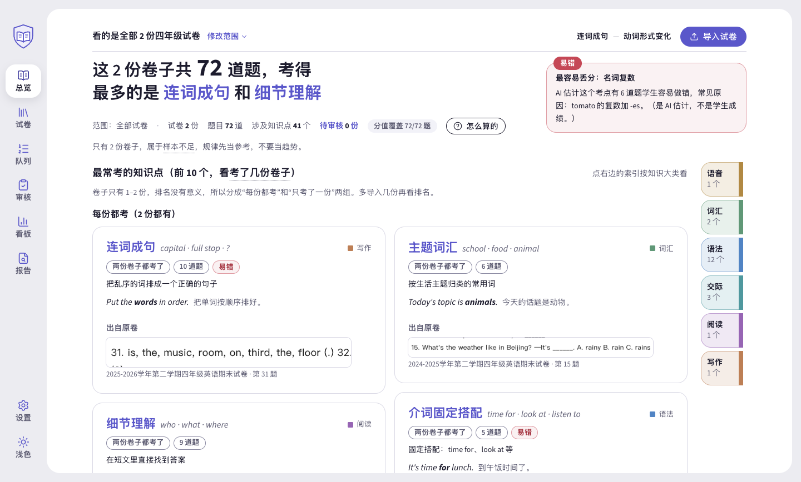
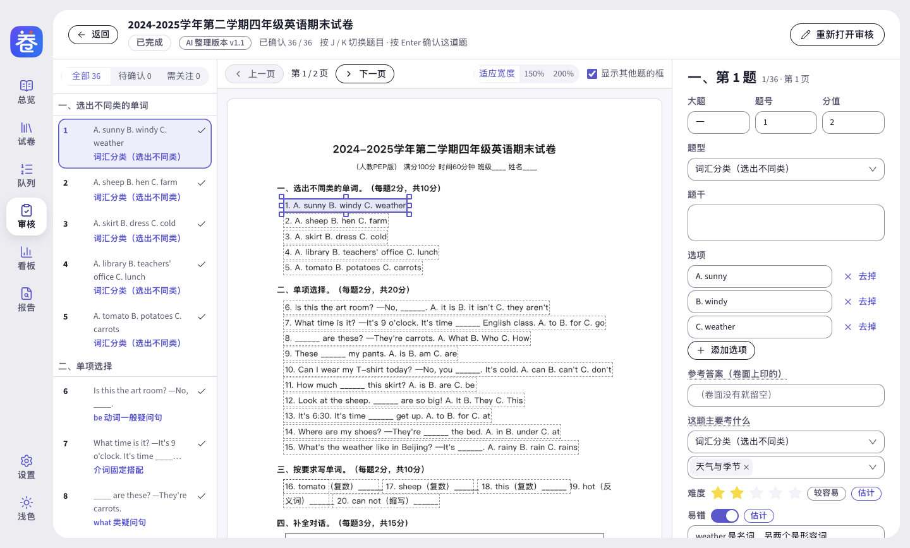
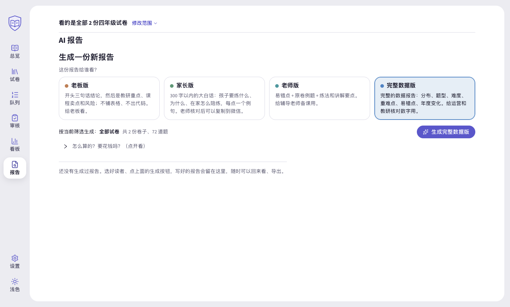

# 卷知 · 小学英语试卷分析

把一摞小学英语试卷，变成一本「考点词典」：今年考了什么、哪里最容易错、和往年比有什么变化，一眼看清；再按读者生成**老板版、老师版、家长版**分析报告。

- 免费、开源，Mac 和 Windows 都有安装包
- 不用注册、不用登录。试卷和结果保存在你自己的电脑上；只有你让 AI 拆题、写报告时，试卷文字才会发给你自己选的 AI 服务商（见[第九部分](#九数据和隐私)）
- 看不懂语法术语也能用：每个考点都配了一句白话解释和一个例句



> **下载地址：[点这里打开下载页](https://github.com/ooohhhooo/juanzhi/releases/latest)**　｜　完整安装说明：[docs/安装指南.md](docs/安装指南.md)

---

## 目录

1. [卷知是什么](#一卷知是什么)
2. [开始之前：先确认三件事](#二开始之前先确认三件事)
3. [系统要求：哪些电脑能装、哪些不能装](#三系统要求哪些电脑能装哪些不能装)
4. [下载哪个文件](#四下载哪个文件)
5. [安装步骤（Mac / Windows）](#五安装步骤)
6. [第一次使用：三步上手](#六第一次使用三步上手)
7. [小白指南：让 AI 助手帮你装（WorkBuddy、豆包、Codex、Claude Code）](#七小白指南让-ai-助手帮你装)
8. [AI 助手还能怎么配合卷知用](#八ai-助手还能怎么配合卷知用)
9. [数据和隐私](#九数据和隐私)
10. [常见问题、已知不足和反馈](#十常见问题已知不足和反馈)
11. [给开发者](#十一给开发者)

---

## 一、卷知是什么

卷知是一个装在电脑上的软件，给**小学英语的辅导老师、教研和运营**用。你把学校的英语期中、期末卷（PDF、Word、手机拍的照片都行）拖进去，它会：

1. **拆题、标注**：用 AI 把每道题拆出来，标上考的是哪个知识点、难不难、容易不容易错。老师在「审核」页可以逐题核对、修改。
2. **统计考点**：总览页把考点做成一本「词典」——每个考点一个词条，写着白话解释、英文例句、考过几份卷子、原卷截图。「分析看板」能看分布、和往年比、找重难点。
3. **按读者出报告**：同一批数据，写成给不同人看的版本。

| 报告版本 | 给谁看 | 写什么 |
|---|---|---|
| 老板版 | 老板、负责人 | 三句话结论：下学期教研先投哪几块、哪些话现在能对外说、有什么风险 |
| 老师版 | 辅导老师 | 易错点、原卷例题、练法和讲解要点，可以拿来备课 |
| 家长版 | 家长（发微信群） | 300 字以内、大白话，3 条「孩子容易错在哪 + 在家怎么问 + 怎么答才算对」 |
| 完整数据版 | 运营、教研 | 分布、题型、难度、重难点、年度变化，方便核对数字 |

**家长版有一道把关**：必须由老师点「我已核对」后才能复制到微信或导出；程序找不到依据的句子会标成「未核实」，要逐句确认或删掉才能继续。卷子少于 3 份时，软件会明说「卷子太少，只能当方向参考」，不会硬下结论。

下面是一段真实生成的家长版（用 DeepSeek 对样例卷生成、复制到微信的原文；每次生成的内容会有所不同）：

> 各位家长好，这次期末有 3 个小地方孩子容易错，在家几分钟就能帮上：
>
> 1. 孩子容易在 tomato（西红柿）变成两个时少写 es。在家做：问孩子“两个西红柿怎么说”。说出 two tomatoes 就对了。
>
> 2. 孩子容易用错 time for 和 time to。在家做：问孩子“吃早饭时间用 time for 还是 time to”。说出 time for 就对了。
>
> 3. 孩子容易把 can not 合起来写时写错。在家做：请孩子把 can not 合起来写成一个词。写出 can't（不能）就对了。
>
> 整体不用太担心，抓住这 3 点就行。

| 逐题审核 | 分析看板 | AI 报告 |
|---|---|---|
|  |  |  |

---

## 二、开始之前：先确认三件事

### 1. 你的电脑能不能装

| 你的电脑 | 能不能装 |
|---|---|
| Mac，系统是 macOS 13 或更新 | ✅ 能 |
| Mac，系统是 macOS 12 或更旧 | ❌ 装不了（如果你还有一台 Windows 电脑，就用那台） |
| Windows 10 或 Windows 11，64 位 | ✅ 能 |
| Windows 7 / 8 / 8.1、32 位 Windows | ❌ 装不了 |

不知道自己电脑是哪种？看[第三部分](#三系统要求哪些电脑能装哪些不能装)的「怎么查」，一分钟就能查到。

### 2. 谁来配置 AI

卷知拆题、写报告要用一个大模型服务（推荐 DeepSeek，也支持通义千问、豆包、Kimi、智谱）。用之前要在软件里填一个 **API Key**——它相当于调用 AI 服务的「账号密码」，在服务商网站上申请，费用由服务商按用量扣（卷知本身免费）。

- **公司统一用的**：一般由管理员申请好，告诉你填什么（或者帮你填好），你不用自己注册。
- **自己用的**：按[第六部分](#六第一次使用三步上手)去 DeepSeek 开放平台注册、充值少量金额、创建一个 API Key。

没有 API Key 也能先装好、先看「示例数据」，只是不能解析新试卷。

### 3. 公司电脑

- 有的公司电脑不让随便装软件。装不上时，请找公司 IT 同事帮忙，把这个 README 的链接发给他就行。
- 360、火绒、电脑管家等杀毒软件可能拦截安装包，因为它没有购买付费的「签名证书」（软件开发者向微软 / 苹果买的身份证明）。在杀毒软件的「信任区 / 白名单」里加上这个文件即可。卷知是开源的，代码都在这个页面上，任何人都能检查。

---

## 三、系统要求：哪些电脑能装、哪些不能装

### Mac

| 系统版本 | 能不能装 |
|---|---|
| macOS 26 Tahoe | ✅ 能（我们实测的就是这个版本） |
| macOS 15 Sequoia | ✅ 能（第一次打开要到「隐私与安全性」里放行，见第五部分） |
| macOS 14 Sonoma | ✅ 能 |
| macOS 13 Ventura | ✅ 能（最低支持版本） |
| macOS 12 Monterey 及更早（11 Big Sur、10.15 Catalina……） | ❌ 不能，打开会提示需要更新的系统 |

- macOS 13–15 的「能」来自安装包声明的最低系统 13.0 和底层技术的官方支持范围，我们没有在这几个版本上逐一实测；实测是在 macOS 26 上做的（Apple 芯片原生和 Intel 版转译都跑过）。
- Apple 芯片（M1 及以后）和 Intel 处理器的 Mac 都支持，各有一个安装包。
- **怎么查**：点屏幕左上角的苹果图标 →「关于本机」，第一行就是系统版本（例如「macOS Sonoma 14.5」），下面写着「芯片：Apple M…」或「处理器：Intel…」。
- **系统太旧怎么办**：macOS 13 及以后在「系统设置 → 通用 → 软件更新」里升级；macOS 12 及更早在「系统偏好设置 → 软件更新」里升级。老机器升不到 macOS 13 的，就没法用卷知，请换一台电脑。
- 这条限制来自卷知用的底层技术（Electron），它只支持 macOS 13 Ventura 及以上。

### Windows

| 系统版本 | 能不能装 |
|---|---|
| Windows 11（64 位，Intel / AMD 处理器） | ✅ 能 |
| Windows 10（64 位），版本 1809 及以上 | ✅ 能 |
| Windows 10 版本 1809 以前（1709、1803 等更小的数字） | ⚠️ 软件能装，但识别照片 / 扫描件里的文字可能用不了，建议先更新系统 |
| ARM 芯片的 Windows 电脑（如骁龙笔记本） | ⚠️ Windows 11 上一般能靠系统自带的兼容功能运行，但我们没有实测；Windows 10 的 ARM 电脑不能 |
| 32 位 Windows | ❌ 不能，安装包只有 64 位 |
| Windows 7、8、8.1 | ❌ 不能，微软和卷知用的底层技术都已不支持 |

- **怎么查版本**：按键盘上的 `Win + R`，输入 `winver` 回车，弹窗里写着「Windows 10」或「Windows 11」以及「版本 22H2」之类。版本号是 1809 或更大（比如 1909、21H2、22H2）就没问题。
- **怎么查 64 位**：打开「设置 → 系统 → 系统信息」（Windows 10 是「设置 → 系统 → 关于」），看「系统类型」是不是「64 位操作系统，基于 x64 的处理器」。
- **识别照片和扫描件里的文字**用的是 Windows 自带的文字识别，需要装中文语言包里的「光学字符识别（OCR）」，步骤见[安装指南第四部分](docs/安装指南.md#四windows-的文字识别ocr和中文语言包)。文字版 PDF 和 Word 不受影响，不用装。

---

## 四、下载哪个文件

1. 打开 **[下载页](https://github.com/ooohhhooo/juanzhi/releases/latest)**（页面是英文的，没关系）。
2. 往下滚，找到 **Assets** 这一栏。如果只显示了几个文件，点下面的「Show all … assets」展开。
3. 按你的电脑点**一个**文件下载：

| 你的电脑 | 点这个文件 |
|---|---|
| Mac，Apple 芯片（M1、M2、M3、M4…） | `Juanzhi-1.1.0-mac-arm64.dmg` |
| Mac，Intel 处理器 | `Juanzhi-1.1.0-mac-x64.dmg` |
| Windows（推荐） | `Juanzhi-1.1.0-win-x64-setup.exe`（安装版） |
| Windows，没有安装权限 | `Juanzhi-1.1.0-win-x64-portable.exe`（免安装版，双击就能用） |

- 文件名里的 `1.1.0` 是版本号，以页面上的最新版为准。
- **不要点** `Source code (zip)` 和 `Source code (tar.gz)`，那是给程序员看的源代码，不是安装包。
- 拿不准 Mac 是哪种芯片就下 Intel 版（`mac-x64`）：Apple 芯片的 Mac 一般也能打开（系统可能提示安装 Rosetta，按提示装即可）；反过来 Apple 芯片的包在 Intel 的 Mac 上打不开。
- **浏览器说「此文件不常被下载」「可能有害」**：Edge 里点文件旁边的「…」→「保留」→「仍然保留」；Chrome 里点「保留」。原因同样是没买签名证书。
- **打不开页面或下载很慢**：国内访问 GitHub 有时不稳定，换个时间再试；或者请公司负责发软件的同事下载好，放到公司网盘 / 群文件里给大家。

---

## 五、安装步骤

### Mac

1. 双击下载好的 `.dmg` 文件，在弹出的窗口里把「卷知」图标拖进右边的「应用程序」文件夹。
2. 打开「应用程序」文件夹，双击「卷知」。
3. 第一次打开会被系统拦一下——因为卷知是免费开源软件，没有购买苹果的开发者证书。放行一次，以后就不会再问：
   - **macOS 13、14**：按住键盘上的 Control 键点「卷知」（或点鼠标右键）→ 选「打开」→ 在弹窗里再点「打开」。
   - **macOS 15 及以后**：先双击一次，看到提示后点「完成」（**不要**点「移到废纸篓」）→ 打开「系统设置」→ 左边点「隐私与安全性」→ 往下滚到「安全性」→ 点「已阻止使用“卷知”」旁边的「仍要打开」→ 输入开机密码 → 点「打开」。
4. **只有系统提示「已损坏，无法打开」时**才做这一步：打开「终端」（按 `Command + 空格`，输入「终端」回车），粘贴下面这一行，按回车，再重新打开卷知：

   ```bash
   xattr -cr "/Applications/卷知.app"
   ```

5. 第一次保存 AI 密钥时，系统可能问「卷知想要使用钥匙串中的机密信息」：输入开机密码，点「始终允许」。

### Windows

**安装版（推荐）：**

1. 双击 `Juanzhi-…-setup.exe`。
2. 如果弹出蓝色窗口「Windows 已保护你的电脑」：点「更多信息」→ 再点「仍要运行」。
3. 安装向导里「为谁安装」选默认的「仅为我」，这样不需要管理员密码；其余保持默认，一路点「下一步」。
4. 装好后，桌面和开始菜单会出现「卷知」，双击打开。

**免安装版：** 把 `Juanzhi-…-portable.exe` 放到桌面或任意文件夹，双击就能用。第一次同样可能出现蓝色窗口，处理方法同上。它每次启动要先解压，会比安装版慢几秒。

**升级到新版本：** 先在卷知里导出一份数据包备份（「设置 → 管理员设置 → 数据包 → 导出数据包」），关掉卷知，再按上面的步骤装新版即可，数据不会丢。Mac 上拖进「应用程序」时选「替换」。

更详细的说明（换电脑、卸载、数据存在哪等）见 **[docs/安装指南.md](docs/安装指南.md)**，软件里「设置 → 关于 → 查看安装指南」也是同一份。

---

## 六、第一次使用：三步上手

1. **选身份**：第一次打开，首页会问你，点「我是运营」或「我是辅导老师」，按它给的三步路线走。
2. **配一次 AI**（一般由管理员做，每台电脑一次）：
   - 到 [DeepSeek 开放平台](https://platform.deepseek.com) 注册、充值少量金额，在「API Keys」里创建一个密钥并复制（只显示一次）。
   - 在卷知里打开「设置」→ 点「展开管理员设置」（这是软件里的一个设置分组，不是电脑的管理员账号）→「AI 服务」→ 服务商选 DeepSeek → 粘贴密钥 →「保存」→「测试连接」，看到「连接成功」就好了。
3. **导入试卷 → 审核 → 出报告**：把试卷文件拖进窗口 → 在「审核」里过一遍每道题的标注 → 打开「AI 报告」，选给谁看（老板 / 老师 / 家长 / 完整数据），点生成。

想先看看效果、不动真实数据：「设置」→「示例数据」→「加载示例数据」，会放进 12 份模拟试卷，随时可以一键清除。

---

## 七、小白指南：让 AI 助手帮你装

不太会装软件的话，可以让电脑上的 AI 助手替你做：**选一个助手 → 把下面对应的那段话整段复制给它 → 它每一步做完会告诉你结果**。

> 🔒 **安全提醒（请先读）**
> 1. **不要把 API Key、开机密码发给任何 AI 助手。** API Key 只在卷知自己的「设置 → AI 服务」里填；要输入开机密码的地方，你自己输入。
> 2. 助手要下载文件、运行命令时，一般会先弹窗问你「是否允许」。看清楚它要做什么再点允许；拿不准就点拒绝，按[第五部分](#五安装步骤)自己装。
> 3. **想让它停下**：直接在对话框里打「停下」，或者点助手界面上的「停止 / 暂停」按钮。

### 选一个 AI 助手

| 助手 | 适合谁 | 怎么获取 | 把话粘贴到哪里 |
|---|---|---|---|
| **WorkBuddy**（腾讯） | 习惯中文界面、不想碰命令的人 | 官网 [workbuddy.cn](https://www.workbuddy.cn/) 下载（Windows 10/11、macOS 都有） | 打开后在主界面的对话输入框里粘贴、发送 |
| **豆包电脑版**（字节） | 已经在用豆包的人 | [豆包官网](https://www.doubao.com) 下载电脑版 | 切到「工作任务」（也叫「豆包工作」）模式，按提示授权「操作电脑」后，在对话框里粘贴。它会像人一样看屏幕、移动鼠标、点按钮，你能看到它在点什么 |
| **Codex**（OpenAI） | 有 ChatGPT 账号的人 | ChatGPT 电脑版里的 Codex，或 Codex 命令行 | 在 Codex 的对话框里粘贴。它会在电脑上执行下载、安装命令，每条命令执行前给你看 |
| **Claude Code**（Anthropic） | 有 Claude 账号的人 | Claude 电脑版里的「Code」，或 Claude Code 命令行 | 在对话框里粘贴，同上 |

> 这几款助手的功能和入口更新很快，以它们官网的最新说明为准。如果中途卡住，就按[第五部分](#五安装步骤)自己点完剩下的步骤。

### 复制给 AI 助手的话：Mac 安装

```text
请帮我在这台 Mac 上安装「卷知」（一个开源的小学英语试卷分析软件）。按下面的步骤做，每一步做完告诉我结果：
1. 查看系统版本和芯片（sw_vers、uname -m）。如果 macOS 低于 13，告诉我「这台 Mac 系统太旧，装不了」并停下。
2. 只从这个地址下载：https://github.com/ooohhhooo/juanzhi/releases/latest 。Apple 芯片（arm64）下载文件名带 mac-arm64 的 .dmg，Intel 芯片（x86_64）下载带 mac-x64 的 .dmg，存到「下载」文件夹。
3. 用 hdiutil attach -nobrowse -readonly 挂载这个 dmg，用 ls /Volumes 找到名字以「卷知」开头的卷。
4. 如果「应用程序」文件夹里已经有「卷知.app」，先问我要不要替换；我同意后先退出卷知，再把旧的移到废纸篓。
5. 用 ditto 把卷里的「卷知.app」复制到 /Applications/卷知.app，然后用 hdiutil detach 推出这个卷。
6. 用 open 打开「/Applications/卷知.app」。如果系统弹出安全提示，告诉我该点哪里，让我自己点。只有系统明确提示「已损坏，无法打开」时，才执行 xattr -cr "/Applications/卷知.app" 后再打开一次。
要求：任何一步失败就停下来告诉我原因；不要换别的下载地址；不要用 sudo；不要关闭或绕过 Gatekeeper 等系统安全功能；不要向我索要开机密码或 API Key。
```

### 复制给 AI 助手的话：Windows 安装

```text
请帮我在这台 Windows 电脑上安装「卷知」（一个开源的小学英语试卷分析软件）。按下面的步骤做，每一步做完告诉我结果：
1. 先检查系统：必须是 64 位的 Windows 10（版本 1809 及以上）或 Windows 11，并且不是 ARM 芯片（可以用 PowerShell 的 (Get-CimInstance Win32_Processor).Architecture 查看，结果是 12 就是 ARM）。不符合就告诉我「这台电脑装不了或没测试过」并停下。
2. 只从这个地址下载：https://github.com/ooohhhooo/juanzhi/releases/latest ，下载文件名带 win-x64-setup.exe 的安装包，存到「下载」文件夹。
3. 打开这个安装包，让安装向导显示出来。向导里的按钮由我自己点（「为谁安装」选「仅为我」，其余保持默认）。如果你能看到屏幕，在我卡住时告诉我该点哪里；如果出现蓝色的「Windows 已保护你的电脑」，告诉我点「更多信息」→「仍要运行」。
4. 装好后从开始菜单打开「卷知」。
5. 如果我需要识别照片或扫描件，一步步告诉我怎么在「设置 → 时间和语言 → 语言和区域」里给「中文（简体，中国）」装上「光学字符识别（OCR）」。
要求：任何一步失败就停下来告诉我原因；不要换别的下载地址；不要以管理员身份运行任何东西；不要关闭或绕过 SmartScreen、杀毒软件等安全功能；不要向我索要开机密码或 API Key。
```

### 复制给 AI 助手的话：升级到新版本

```text
请帮我把电脑上的「卷知」升级到最新版：
1. 先提醒我在卷知里「设置 → 管理员设置 → 数据包 → 导出数据包」备份一份，等我说「好了」再继续。
2. 让我自己退出卷知（不要强制结束它）。
3. 然后按上面安装那段话的步骤，下载最新版并安装；Mac 上替换「应用程序」里旧的卷知.app，Windows 上直接运行新的 setup.exe。
4. 打开卷知，在「设置 → 关于」里确认版本号已经变成新的。
要求同安装那段话：失败就停下，不换下载地址，不用管理员权限，不绕过安全功能，不索要密码和 API Key。
```

---

## 八、AI 助手还能怎么配合卷知用

卷知现在是一个**有界面的桌面软件**，还没有给 AI 助手直接调用的命令行接口。按目前的版本，AI 助手可以这样配合：

| 你想做的事 | 现在怎么做 |
|---|---|
| 安装、升级 | 见上面第七部分，把那段话交给助手 |
| 遇到问题想排查 | 把报错截图和这份 README、[安装指南](docs/安装指南.md) 的链接一起发给助手，让它对照着帮你查 |
| 把报告改成别的样子 | 在卷知里导出报告（Word、PDF 或 .md 文本文件），把文件交给助手，让它改写成家长会发言稿、教研 PPT 大纲、群通知等。**改写后的内容请老师再核对一遍** |
| 汇总多份报告 | 把导出的多份报告一起交给助手，让它对比、做成汇总表 |
| 让助手替你点界面 | 能「操作电脑」的助手（豆包工作、WorkBuddy 等）理论上可以替你点卷知的按钮，我们没有实测；「审核题目」和「我已核对」这两步请老师亲自做 |

> 发给 AI 助手的报告里如果有学生姓名、学校名，请先删掉。

**计划中的下一个版本**会加上命令行接口：到时 Codex、Claude Code、WorkBuddy 这类能执行命令的助手，可以直接让卷知「导入这几份试卷 → 解析 → 生成家长版报告 → 导出」，并把结果读回来；你自己也可以用一行命令完成同样的事。做好后会更新这一部分。

---

## 九、数据和隐私

- **数据保存在你自己的电脑上**，没有云端、没有账号。位置：Mac 在「个人文件夹 / 资源库 / Application Support / english-exam-workbench」，Windows 在 `%APPDATA%\english-exam-workbench`。
- **只有你让 AI 解析试卷、生成报告时**，才会把试卷文字发给你自己选的 AI 服务商；如果你还配了「能看图的 AI 模型」（视觉模型），识别不好的扫描页图片也会发过去。卷知的作者收不到你的任何数据。
- API Key 加密保存在本机（Mac 用系统钥匙串），界面和日志里都不显示，导出的数据包里也没有。
- 换电脑、备份：「设置 → 管理员设置 → 数据包」导出 / 导入，详见[安装指南第六部分](docs/安装指南.md#六换电脑--备份数据)。

---

## 十、常见问题、已知不足和反馈

- 打不开、白屏、识别乱码等常见问题：见[安装指南第九部分](docs/安装指南.md#九常见问题)。
- 遇到问题或有建议：到 [Issues 页面](https://github.com/ooohhhooo/juanzhi/issues) 点「New issue」新建一条，写上**电脑系统版本、卷知版本（设置 → 关于）、做了什么、看到了什么**，附截图。**请不要贴学生姓名、API Key 等隐私信息。**

**目前已知的不足（如实说明）**

- Windows 版已在 GitHub 的云端 Windows 机器上跑通导入 PDF / Word、拆题、看板、出报告、导出 PDF，但还没有在真人的 Windows 电脑上完整走过一遍。如果你是第一批 Windows 用户，遇到问题请一定反馈，我们会尽快修。
- **Windows 上识别照片、扫描件里的文字还在验证中**：导入照片后如果识别不出文字，可以先改用 PDF / Word，或者在「设置 → 管理员设置 → AI 服务」里填一个能看图的视觉模型。
- 导出的 Word 文件还没在 Word / WPS 里逐一打开检查过，排版有问题请反馈。
- 「难度」「易错」是 AI 根据题目估计的，不是学生的真实得分；卷子少的时候，结论只能当方向参考。

---

## 十一、给开发者

技术栈：Electron 45 + React 19 + TypeScript + Ant Design 6，数据库用 Node 内置的 `node:sqlite`，没有原生模块。

```bash
npm ci
npm run dev            # 开发模式
npm run typecheck      # 类型检查
npm run test:unit      # 单元测试
npm run test:e2e       # 端到端测试（会先构建）
npm run dist:mac       # 打 Mac 安装包（dmg，arm64 + x64）
npm run dist:win       # 打 Windows 安装包（安装版 + 免安装版）
```

- 设计说明：[docs/设计方案.md](docs/设计方案.md)；界面设计系统：[DESIGN.md](DESIGN.md)；产品定位：[PRODUCT.md](PRODUCT.md)；各版本的交付说明和审核记录在 [docs/](docs/) 下。
- 安装包没有签名和公证，所以第一次打开要手动放行。

## 许可

[MIT](LICENSE) © 2026 ooohhhooo。可以免费使用、修改和分发。
