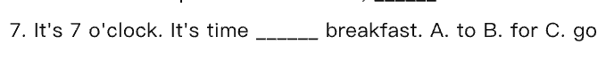
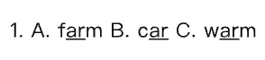
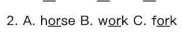
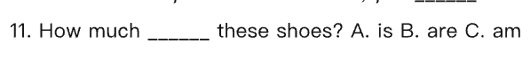

<!-- 由「英语校考分析工作台」导出（AI 草稿 · 请老师核对后再使用）；引用的题目截图在同名文件夹「export-dark」里 -->

# 四年级 下学期 2024–2026学年 期末 考情分析报告（完整数据版）· 2026-10-27

> 说明：难度与易错点为 AI 估计，非学生成绩统计。样本偏小：当前范围内只有 2 份卷子（不足 5 份），出现率等比例可能只是一两份卷子的差别；样本不足：只有 2 份卷子（少于 3 份），不下“难点”结论，只能说“这几份卷子里是这样”，不能当规律；年度变化的样本偏小：目标学年只有 1 份，基线学年只有 1 份（不足 5 份）。结论仅供参考。

## 样本概览
卷子 2 份，题目 72 道；覆盖学年：2024-2025学年、2025-2026学年。

## 知识点分布
**结论**：一级知识点共 12 个，二级知识点里出现份数最多的是 连词成句（2/2 份）。
**依据**：
| 层级 | 名称 | 出现份数/总份数 | 题数 | 分值占比 |
| --- | --- | --- | --- | --- |
| 一级 | 语音 | 1/2 | 5 | 5% |
| 一级 | 词汇 | 2/2 | 9 | 7% |
| 一级 | 名词 | 2/2 | 6 | 4% |
| 一级 | 代词 | 2/2 | 6 | 2% |
| 一级 | 介词 | 2/2 | 8 | 5% |
| 一级 | 动词与情态动词 | 2/2 | 7 | 6% |
| 一级 | 时态 | 1/2 | 5 | 2% |
| 一级 | 形容词与副词 | 1/2 | 4 | 2% |
| 一级 | 句型 | 2/2 | 12 | 10.5% |
| 一级 | 功能交际 | 2/2 | 14 | 11.5% |

其余略。
**建议**：先抓出现份数最多的几个二级知识点，其余作个例处理。

## 题型与分值
**结论**：共 9 种题型，题数最多的是 单项选择（20 题）。
**依据**：
| 题型 | 题数 | 分值合计 | 分值占比 | 平均难度 |
|---|---|---|---|---|
| 单项选择 | 20 | 40 | 20% | 2.4 |
| 补全对话 | 10 | 30 | 15% | 2.4 |
| 用所给词的适当形式填空 | 10 | 20 | 10% | 2.4 |
| 连词成句 | 10 | 30 | 15% | 2.7 |
| 语音辨析 | 5 | 10 | 5% | 2.8 |
| 阅读选择 | 5 | 15 | 7.5% | 2.6 |
| 阅读判断 | 5 | 15 | 7.5% | 1.8 |
| 词汇分类（选出不同类） | 5 | 10 | 5% | 2.2 |
| 书面表达 | 2 | 30 | 15% | 4.5 |
**建议**：按题数从多到少安排练习。

## 难度结构
**结论**：难度分布见下表（AI 估计）。
**依据**：
| 难度 | 题数 | 占比 |
|---|---|---|
| 1 | 3 | 4.2% |
| 2 | 35 | 48.6% |
| 3 | 31 | 43.1% |
| 4 | 2 | 2.8% |
| 5 | 1 | 1.4% |
**建议**：保持梯度。

## 重点与难点
**结论**：重点看 连词成句、细节理解、购物。
**依据**：出现份数 连词成句 2/2；细节理解 2/2；购物 2/2。
**建议**：围绕这几个点出专项练习。

## 易错点预警
**结论**：名词复数 易错，原因：tomato 的复数加 -es；sheep 单复数同形。
**依据**：
- 名词复数：tomato 的复数加 -es；sheep 单复数同形。样本：[2025-2026学年第二学期四年级英语期末试卷 · 16] （用所给词的适当形式填空：Look at the ____ (sheep).）；[2025-2026学年第二学期四年级英语期末试卷 · 17] （用所给词的适当形式填空：Those are ____ (tomato).）
- 介词固定搭配：time for + 名词，time to + 动词；time to + 动词原形。样本：[2025-2026学年第二学期四年级英语期末试卷 · 7] （单项选择：It's 7 o'clock. It's time ____ breakfast…）；[2025-2026学年第二学期四年级英语期末试卷 · 13] （单项选择：It's 9:00 p.m. It's time ____ go to bed.）
- 词汇运用与变形：can not 的缩写是 can't；tomato 是单数，另两个是复数。样本：[2024-2025学年第二学期四年级英语期末试卷 · 20] （用所给词的适当形式填空：can not（缩写）____）；[2024-2025学年第二学期四年级英语期末试卷 · 5] （词汇分类（选出不同类）：A. tomato B. potatoes C. carrots）
- 字母与字母组合发音：ea 可读 /iː/ 或 /e/，head 的读音与另两个不同；warm 中 ar 读 /ɔː/，与 farm、car 的 /ɑː/ 不同。样本：[2025-2026学年第二学期四年级英语期末试卷 · 1] （语音辨析：A. farm B. car C. warm）；[2025-2026学年第二学期四年级英语期末试卷 · 2] （语音辨析：A. horse B. work C. fork）
- 购物：shoes 是复数，be 动词用 are；this skirt 是单数，用 is。样本：[2025-2026学年第二学期四年级英语期末试卷 · 11] （单项选择：How much ____ these shoes?）；[2024-2025学年第二学期四年级英语期末试卷 · 11] （单项选择：How much ____ this skirt?）
- 特殊疑问句：shoes 是复数，be 动词用 are；this skirt 是单数，用 is。样本：[2025-2026学年第二学期四年级英语期末试卷 · 11] （单项选择：How much ____ these shoes?）；[2024-2025学年第二学期四年级英语期末试卷 · 11] （单项选择：How much ____ this skirt?）
**建议**：对照样本题讲评。

补充：介词搭配要注意，It's time for 后接动词，It's time to 后接名词〔与题目解释矛盾，请核对〕。

补充：另见  的第 99 题。

## 教学建议
1. 优先复习出现份数最多的知识点（知识点分布）。
2. 对易错点做专项讲评（易错点预警）。
3. 保持题型与难度梯度（题型与分值）。