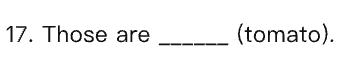
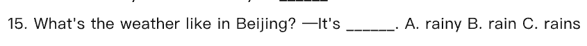
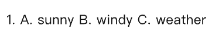
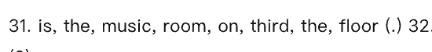
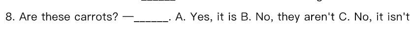

<!-- 由「英语校考分析工作台」导出（AI 草稿 · 请老师核对后再使用）；引用的题目截图在同名文件夹「ops-full」里 -->

# 四年级 下学期 2024–2026学年 期末 考情分析报告（完整数据版）· 2026-10-27

> 说明：难度与易错点为 AI 估计，非学生成绩统计。样本偏小：当前范围内只有 2 份卷子（不足 5 份），出现率等比例可能只是一两份卷子的差别；样本不足：只有 2 份卷子（少于 3 份），不下“难点”结论，只能说“这几份卷子里是这样”，不能当规律；年度变化的样本偏小：目标学年只有 1 份，基线学年只有 1 份（不足 5 份）。结论仅供参考。

## 样本概览
2 份卷子，72 道题；覆盖学年：2024-2025学年、2025-2026学年。

## 知识点分布
**结论**：“写作与书面表达”分值占比最高，为 30%（含连词成句等）；“功能交际”“阅读理解”“句型”也是题数或分值占比靠前的一级知识点。
**依据**：写作与书面表达 2/2 份、12 题、30%（含连词成句等）；功能交际 2/2 份、14 题、11.5%；阅读理解 2/2 份、10 题、15%；句型 2/2 份、12 题、10.5%；二级里连词成句 2/2 份、10 题、15%，细节理解 2/2 份、9 题、13.5%。
**建议**：教研组可先围绕“写作与书面表达”“功能交际”“阅读理解”“句型”做专题核对，明确一级占包含二级后的口径，再排复习顺序。

## 题型与分值
**结论**：单项选择和补全话题量靠前，书面表达题数少但单题分值高，平均难度偏难（AI估计）。
**依据**：单项选择 20 题、40 分、20%；补全对话 10 题、30 分、15%；连词成句 10 题、30 分、15%；书面表达 2 题、30 分、15%；阅读选择与阅读判断各 5 题、各 15 分、各 7.5%。阅读判断平均难度偏易，书面表达平均难度偏难。
**建议**：组卷和复习时不要只看题数，应把书面表达 2 题 15% 的分值占比与实际作答时长结合起来安排。

## 难度结构
**结论**：整体以偏易和中等难度为主（AI估计），偏难和特难题只占很少题量。
**依据**：难度 2 有 35 题、占 48.6%；难度 3 有 31 题、占 43.1%；难度 1 有 3 题、占 4.2%；难度 4 有 2 题、占 2.8%；难度 5 有 1 题、占 1.4%。
**建议**：可把难度 2、难度 3 作为基础巩固重点，难度 4、难度 5 作为提优观察题，避免在偏难易错点上平均用力。

## 重点与难点
**结论**：样本只有 2 份，按提示不判断“难点”；从出现率、题数、分值看，“写作与书面表达”“功能交际”“阅读理解”“句型”可作为本次分析的重点。
**依据**：写作与书面表达 2/2 份、12 题、30%（含连词成句等）；功能交际 2/2 份、14 题、11.5%；阅读理解 2/2 份、10 题、15%；句型 2/2 份、12 题、10.5%。这几份卷子里“书面表达”平均难度偏难（AI估计），“名词复数”AI估计容易错的题有 6 道，“介词固定搭配”AI估计容易错的题有 4 道，但不据此判断年级普遍难点。
**建议**：重点知识点做高覆盖复习；对平均难度偏难或 AI 估计易错题多的知识点，只在样本卷层面跟进，待样本充足后再验证是否构成难点。

## 易错点预警
**结论**：AI 估计的主要易错点集中在名词复数、介词固定搭配、购物/特殊疑问句、主题词汇/谈论天气、字母与字母组合发音、连词成句、一般疑问句与简略回答；其中购物和特殊疑问句易错原因相同，主题词汇和谈论天气易错原因部分相同。
**依据**：下表按合并后的易错原因列示，出现份数均来自输入。

| 合并知识点 | 易错原因 | 出现份数/总份数 | 样本题 |
|---|---|---|---|
| 名词复数 | tomato 的复数加 -es；sheep 单复数同形 | 2/2 | [2025-2026学年第二学期四年级英语期末试卷 · 16] 、[2025-2026学年第二学期四年级英语期末试卷 · 17]  |
| 词汇运用与变形 | can not 的缩写是 can't；tomato 是单数，另两个是复数 | 1/2 | [2024-2025学年第二学期四年级英语期末试卷 · 20] 、[2024-2025学年第二学期四年级英语期末试卷 · 5]  |
| 介词固定搭配 | time for + 名词，time to + 动词；time to + 动词原形 | 2/2 | [2025-2026学年第二学期四年级英语期末试卷 · 7] 、[2025-2026学年第二学期四年级英语期末试卷 · 13]  |
| 字母与字母组合发音 | ea 可读 /iː/ 或 /e/，head 的读音与另两个不同；warm 中 ar 读 /ɔː/，与 farm、car 的 /ɑː/ 不同 | 1/2 | [2025-2026学年第二学期四年级英语期末试卷 · 1] 、[2025-2026学年第二学期四年级英语期末试卷 · 2]  |
| 购物、特殊疑问句 | shoes 是复数，be 动词用 are；this skirt 是单数，用 is | 2/2 | [2025-2026学年第二学期四年级英语期末试卷 · 11] 、[2024-2025学年第二学期四年级英语期末试卷 · 11]  |
| 主题词汇、谈论天气 | It's 后面要用形容词 rainy；主题词汇还涉及 weather 是名词，另两个是形容词 | 主题词汇 2/2；谈论天气 2/2 | [2024-2025学年第二学期四年级英语期末试卷 · 15] 、[2024-2025学年第二学期四年级英语期末试卷 · 1]  |
| 连词成句 | 序数词 third 前要加 the | 2/2 | [2025-2026学年第二学期四年级英语期末试卷 · 31]  |
| 一般疑问句与简略回答 | these 是复数，回答要用 they | 2/2 | [2025-2026学年第二学期四年级英语期末试卷 · 8]  |

**建议**：优先围绕名词复数、介词固定搭配、购物/特殊疑问句做专项讲评；1/2 份里的语音和词汇运用与变形只作为个例提醒，不扩大为年级共性易错点。

## 教学建议
1. 优先抓“写作与书面表达”30%（含连词成句等），把连词成句 15% 和书面表达 15% 分开安排限时训练；连词成句易错点可结合序数词 third 前要加 the 进行讲评。（对应“知识点分布”“重点与难点”“易错点预警”）
2. 对“名词复数”AI估计容易错的题有 6 道，重点练 tomato 加 -es、sheep 单复数同形，可用 [2025-2026学年第二学期四年级英语期末试卷 · 16] 、[2025-2026学年第二学期四年级英语期末试卷 · 17]  做课堂小测。（对应“易错点预警”）
3. 把“购物”和“特殊疑问句”合并复习 How much 句型的 be 动词选择：shoes 是复数用 are，this skirt 是单数用 is，结合 [2025-2026学年第二学期四年级英语期末试卷 · 11] 、[2024-2025学年第二学期四年级英语期末试卷 · 11]  做对比练习〔未核实〕。（对应“易错点预警”）
4. 对“介词固定搭配”的 time for + 名词、time to + 动词原形做选择对比练习，并结合 [2025-2026学年第二学期四年级英语期末试卷 · 7] 、[2025-2026学年第二学期四年级英语期末试卷 · 13]  使用；该结论仅来自这 2 份卷子。（对应“知识点分布”“易错点预警”）
5. 阅读理解一级占 15%、细节理解二级占 13.5%，AI 估计容易错的题为 0 道，可维持现有阅读判断、阅读选择训练节奏，不额外加大题量。（对应“题型与分值”“难度结构”）