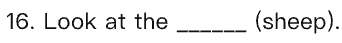
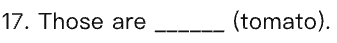
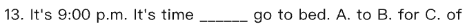
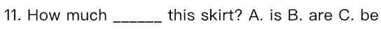
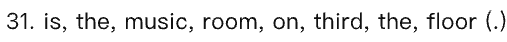
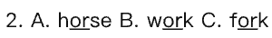

<!-- 由「英语校考分析工作台」导出（AI 草稿 · 请老师核对后再使用；数据来源：2 份校考卷（2024-2025、2025-2026 学年））；引用的题目截图在同名文件夹「teacher-r2」里 -->

# 四年级 下学期 2024–2026学年 期末 考情分析报告（老师版）· 2026-10-27

> 说明：难度与易错点为 AI 估计，非学生成绩统计。只有 2 份卷子，样本太少：只能说“这几份卷子里是这样”，不下“难点”结论，不能当规律；年度变化：2025-2026 学年只有 1 份，2024-2025 学年只有 1 份，比较只能当线索，结论仅供参考。

## 易错点（按重要程度排序）

### 名词复数
- **错在哪**：正确：tomato 的复数加 -es。正确：sheep 单复数同形。常见错误：给 sheep 加 s。
- **原卷例题**：[2025-2026学年第二学期四年级英语期末试卷 · 16]（用所给词的适当形式填空：Look at the ____ (sheep).）；[2025-2026学年第二学期四年级英语期末试卷 · 17]（用所给词的适当形式填空：Those are ____ (tomato).）  
- **练法**：用所给词的适当形式填空练 5 道，先圈出名词，再判断要不要变复数；单独听写 tomato、sheep 两个词。
- **讲解要点**：用例句 I see two dogs. 我看到两只狗。先让学生知道复数一般看词尾；但 tomato 加 -es，sheep 一个也是 sheep，两个也是 sheep。

### 介词固定搭配：time for 和 time to
- **错在哪**：正确：time for 后面接名词。正确：time to 后面接动词原形。常见错误：两个用混，time for 后接动词，time to 后接名词。
- **原卷例题**：[2025-2026学年第二学期四年级英语期末试卷 · 7]（单项选择：It's 7 o'clock. It's time ____ breakfast…）；[2025-2026学年第二学期四年级英语期末试卷 · 13]（单项选择：It's 9:00 p.m. It's time ____ go to bed.）  
- **练法**：单项选择练 4 道，分别给名词和动词填空；让学生口头说“time for + 名词，time to + 动词原形”再选。
- **讲解要点**：用例句 It's time for lunch. 到午饭时间了。说清楚 for 后面跟 lunch 这类名词〔未核实〕；原卷例题里 go to bed 是动词原形，所以用 to〔未核实〕。

### 购物与特殊疑问句里的 be 动词
- **错在哪**：正确：shoes 是复数，用 are。正确：this skirt 是单数，用 is。常见错误：看到 shoes 还用 is；看到 this skirt 还用 are。
- **原卷例题**：[2025-2026学年第二学期四年级英语期末试卷 · 11]（单项选择：How much ____ these shoes?）；[2024-2025学年第二学期四年级英语期末试卷 · 11]（单项选择：How much ____ this skirt?）  
- **练法**：单项选择练 4 道，先把主语圈出来，判断单复数，再选 is 或 are；把 these shoes、this skirt 两组词反复读。
- **讲解要点**：没有对得上例句，直接用原卷例题里的单词：these shoes 是复数，用 are；this skirt 是单数，用 is。

### 天气主题词汇：形容词和名词
- **错在哪**：正确：It's 后面要用形容词 rainy。常见错误：写成 It's weather。正确：sunny、windy 是形容词，weather 是名词。常见错误：把 weather 当形容词用。
- **原卷例题**：[2024-2025学年第二学期四年级英语期末试卷 · 15]（单项选择：What's the weather like in Beijing? —It'…）；[2024-2025学年第二学期四年级英语期末试卷 · 1]（词汇分类（选出不同类）：A. sunny B. windy C. weather）  
- **练法**：词汇分类练 3 组，每组一个名词两个形容词；做天气问答口头练习，回答用 It's rainy / sunny / windy〔未核实〕。
- **讲解要点**：没有对得上例句，直接用原卷例题里的单词：rainy、sunny、windy 是形容词，放在 It's 后面；weather 是名词，不能放在 It's 后面。

### 连词成句：序数词 third 前要加 the
- **错在哪**：正确：third 前要加 the。常见错误：漏掉 the，或 the third 放错位置。
- **原卷例题**：[2025-2026学年第二学期四年级英语期末试卷 · 31]（连词成句：is, the, music, room, on, third, the, fl…） 
- **练法**：连词成句练 5 道，先找句首大写和句末标点，再找固定搭配，遇到 third 就检查前面有没有 the〔未核实〕。
- **讲解要点**：没有对得上例句，用原卷例题里的单词：third 前要加 the；把 the third 看成一个整体，再放 on the third floor。

### 语音辨析：字母组合发音
- **错在哪**：正确：warm 中 ar 读 /ɔː/。常见错误：把 warm 读成 farm、car 的 /ɑː/〔未核实〕。正确：work 中 or 读 /ɜː/。常见错误：把 work 读成 horse、fork 的 /ɔː/〔未核实〕。
- **原卷例题**：[2025-2026学年第二学期四年级英语期末试卷 · 1]（语音辨析：A. farm B. car C. warm）；[2025-2026学年第二学期四年级英语期末试卷 · 2]（语音辨析：A. horse B. work C. fork）  
- **练法**：听音读词练 5 组，先读 farm、car、warm，再读 horse、work、fork，读错立刻纠正。
- **讲解要点**：没有对得上例句，用原卷例题里的单词：warm 的 ar 和 farm、car 不一样；work 的 or 和 horse、fork 不一样。这份卷子里有，不能当普遍规律。

## 备课建议
1. 书面表达和连词成句分值最高，要专项练：连词成句每天 5 道，按“先找句首大写和句末标点、再列词成句”的步骤练；书面表达让学生围绕一个话题先列三句话再写。
2. 单项选择覆盖面大，复习时把名词复数、介词固定搭配、be 动词单复数、天气形容词这几类错题挑出来做成 10 道选择题，限时做。
3. 词汇题里容易考词形和归类，每天听写 tomato、sheep、weather、rainy、sunny、windy，并让学生说出哪个是名词哪个是形容词。
4. 语音辨析这份卷子里有，但只有一份，不必当重点，可带读 farm、car、warm、horse、work、fork 这 6 个词让学生听音区分。
5. 阅读理解题分值不低，但 AI 估计易错少，可让学生先读题再回短文找答案，练 2 篇即可。