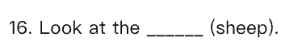
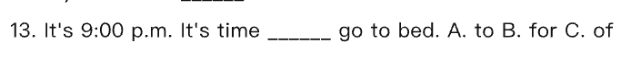
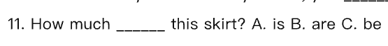
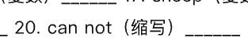

<!-- 由「英语校考分析工作台」导出（AI 草稿 · 请老师核对后再使用）；引用的题目截图在同名文件夹「tutor-teacher」里 -->

# 四年级 下学期 2024–2026学年 期末 考情分析报告（老师版）· 2026-10-27

> 说明：难度与易错点为 AI 估计，非学生成绩统计。样本提示：当前范围只有 2 份卷子（不足 5 份），出现率等比例可能只是一两份卷子的差别；只有 2 份卷子（少于 3 份），不下“难点”结论，只能说“这几份卷子里是这样”，不能当规律；年度变化的样本偏小：目标学年只有 1 份，基线学年只有 1 份（不足 5 份）。结论仅供参考。

## 易错点（按重要程度排序）

### 名词复数
- **错在哪**：tomato 的复数加 -es；sheep 单复数同形，孩子容易给 sheep 加 -s〔与题目解释矛盾，请核对〕。
- **原卷例题**：[2025-2026学年第二学期四年级英语期末试卷 · 16] （用所给词的适当形式填空：Look at the ____ (sheep).）；[2025-2026学年第二学期四年级英语期末试卷 · 17] （用所给词的适当形式填空：Those are ____ (tomato).）
- **练法**：用原卷里 6 道名词复数题，先口头说复数，再写句填空；重点混练 tomato、sheep。
- **讲解要点**：先看句子里的数量词，two 后面要变复数〔未核实〕；拿“I see two dogs. 我看到两只狗。”讲一般加 -s，再单独记 tomato 加 -es、sheep 不加 -s〔与题目解释矛盾，请核对〕。

### 介词固定搭配
- **错在哪**：time for 后面加名词，time to 后面加动词原形。
- **原卷例题**：[2025-2026学年第二学期四年级英语期末试卷 · 7] （单项选择：It's 7 o'clock. It's time ____ breakfast…）；[2025-2026学年第二学期四年级英语期末试卷 · 13] （单项选择：It's 9:00 p.m. It's time ____ go to bed.）
- **练法**：把原卷里 5 道介词搭配题拿出来，先判断后面是名词还是动词，再选 for / to。
- **讲解要点**：用“It's time for lunch. 到午饭时间了。”记住 for 后是名词，to 后是动词原形。

### be 动词和名词单复数要一致
- **错在哪**：shoes 是复数，be 动词用 are；this skirt 是单数，用 is。
- **原卷例题**：[2025-2026学年第二学期四年级英语期末试卷 · 11] （单项选择：How much ____ these shoes?）；[2024-2025学年第二学期四年级英语期末试卷 · 11] （单项选择：How much ____ this skirt?）
- **练法**：把购物 7 道、特殊疑问句 5 道里的 How much 题挑出来练，先圈出主语名词，再选 is / are。
- **讲解要点**：看主语是单数还是复数；用“They are at school. 他们在学校。”提醒 are 配复数，is 配单数。

### 语音
- **错在哪**：ea 可读 /iː/ 或 /e/，head 的读音与另两个不同；warm 中 ar 读 /ɔː/，与 farm、car 的 /ɑː/ 不同；work 中 or 读 /ɜː/，其余读 /ɔː/。
- **原卷例题**：[2025-2026学年第二学期四年级英语期末试卷 · 1] （语音辨析：A. farm B. car C. warm）；[2025-2026学年第二学期四年级英语期末试卷 · 2] （语音辨析：A. horse B. work C. fork）
- **练法**：用原卷里 5 道语音辨析题，先听老师读，再圈出读音不同的词；读不准时回到 head、warm、work 三个例词。
- **讲解要点**：用“fish and fox 鱼和狐狸，开头读音相同。”让孩子先找相同音，再记特殊词；head、warm、work 要单独记。

### 词汇运用与变形
- **错在哪**：can not 的缩写是 can't；分类题里 tomato 是单数，另两个是复数。
- **原卷例题**：[2024-2025学年第二学期四年级英语期末试卷 · 20] （用所给词的适当形式填空：can not（缩写）____）；[2024-2025学年第二学期四年级英语期末试卷 · 5] （词汇分类（选出不同类）：A. tomato B. potatoes C. carrots）
- **练法**：用原卷里 7 道词形与分类题做口头快答，重点练 can not → can't 和 tomato / potatoes 单复数〔未核实〕。
- **讲解要点**：先看词形和意思；用“Hot is the opposite of cold. 热的反义词是冷。”提醒分类要看懂词义，再记 can't 和 tomato 的单复数〔未核实〕。

### 主题词汇和天气
- **错在哪**：It's 后面要用形容词 rainy；weather 是名词，另两个是形容词。
- **原卷例题**：[2024-2025学年第二学期四年级英语期末试卷 · 15] （单项选择：What's the weather like in Beijing? —It'…）；[2024-2025学年第二学期四年级英语期末试卷 · 1] （词汇分类（选出不同类）：A. sunny B. windy C. weather）
- **练法**：把主题词汇 6 道、谈论天气 3 道里的天气题拿出来，先做分类，再补全 It's + 形容词。
- **讲解要点**：用“What's the weather like today? 今天天气怎么样？”问天气；回答用 It's 加形容词 rainy，不用 weather。

## 备课建议
1. 名词复数：把原卷里 6 道名词复数题做成改错单，逐题说“加 -es 还是不加 s”。
2. 介词固定搭配：把原卷里 5 道 time for / time to 题集中做填空，孩子先圈后面是名词还是动词。
3. be 动词和单复数：从购物 7 道、特殊疑问句 5 道里挑出 How much 题，先划主语再选 is / are〔未核实〕。
4. 语音和词形：原卷 5 道语音题和 7 道词形题做口答，重点记 head、warm、work 的发音，并把 can not 写成 can't〔未核实〕。
5. 天气表达：把原卷里 6 道主题词汇、3 道天气题合练，先分类 sunny/windy/rainy/weather，再补全 It's + 形容词。